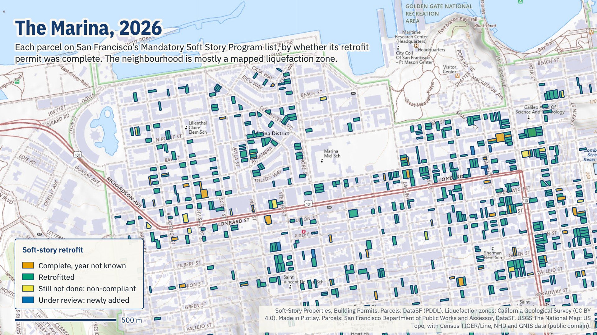
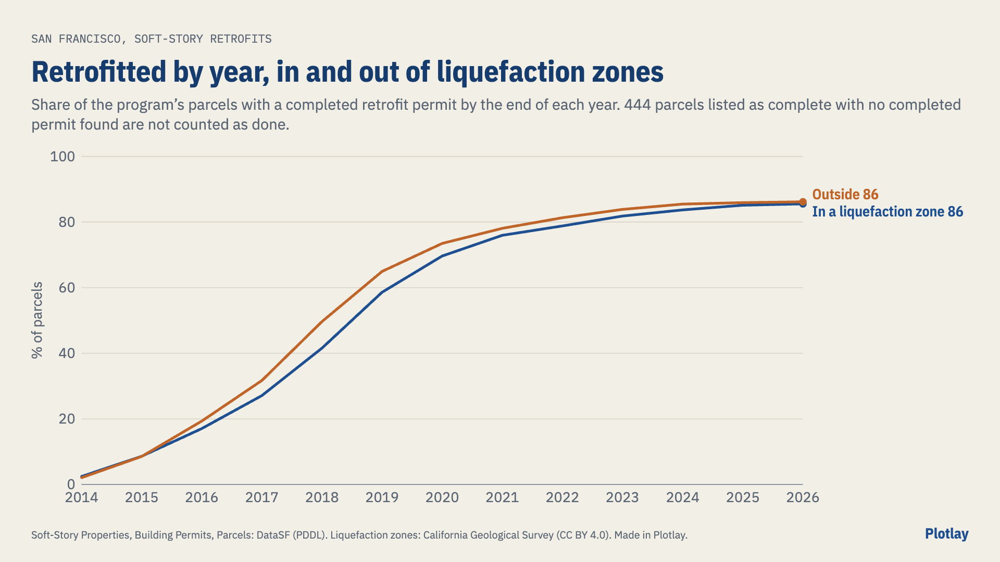

# How far has San Francisco's soft-story retrofit program got?

San Francisco requires wood-frame apartment buildings built before 1978, with five or more homes and two or more storeys over a weak ground floor of garages or shops, to be strengthened against earthquakes.

Every building on San Francisco's Mandatory Soft Story Retrofit Program list, parcel by parcel, by the year its retrofit was finished, against the state's mapped liquefaction zones. **Live version, with an interactive map:** [getplotlay.com/showcase/sf-soft-story](https://www.getplotlay.com/showcase/sf-soft-story/)



A soft-story building has a weak ground floor, garages or shopfronts under flats, that can fold in an earthquake. In 2013 San Francisco required the owners of about 5,000 wood-frame buildings of three or more storeys and five or more units to strengthen them, in four tiers with deadlines from 2017 to 2020. **On the program's list as of 2026-10-07, 4,662 of 4,901 parcels (95.1%) are listed complete. In the state's mapped liquefaction zones, where shaking is worst, it is 657 of 698 (94.1%), and 37 are still listed non-compliant.**

The city publishes the list (each building's tier and status today) and every building permit, but not when each building was finished, and not which ones stand on ground that can liquefy. Here the completion date of each parcel's soft story permit gives the year, the state's liquefaction zones give the ground, and [Plotlay](https://www.getplotlay.com) puts them on one map with a slider from 2014 to 2026.

[](https://app.plotlay.io/?example=sf-soft-story&as=client)

## What the data says

| | All parcels | In a liquefaction zone | Outside |
|---|---|---|---|
| Parcels on the list | 4,901 | 698 | 4,201 |
| Listed complete | 4,662 (95.1%) | 657 (94.1%) | 4,003 (95.3%) |
| Listed non-compliant | 227 | 37 | 190 |
| Done by the end of 2018 (permit completed) | 48.5% | 41.5% | 49.6% |
| Done by the end of 2026 (permit completed) | 86.1% | 85.5% | 86.2% |

- **The zones lagged, by design.** The ordinance put buildings in mapped liquefaction zones in Tier IV, the last deadline (15 September 2020), unless they were Tier I. 405 of the 698 zone parcels are Tier IV. At the end of 2018 the zones were 8.1 points behind; by 2026 they have all but caught up.
- **The busiest year was 2018**, with 857 parcels finished.
- **By each deadline:** Tier II 62.6% of its parcels had a completed permit by 15 September 2018, Tier III 62.6% by 2019, Tier IV 57.8% by 2020. Today Tier IV is 92.3% complete, with 76 non-compliant.



### Read it carefully

- **Completion years come from permits.** A parcel's year is the earliest completed date of a completed soft story permit on it. 444 parcels the program lists as complete have no such permit in the open data (a permit worded differently, or work done under another permit); they count as complete in the status figures and are never counted as done in the year-by-year figures, so those end at 86.1%, below the 95.1% listed complete.
- **The program's status is the authority.** A completed permit is not the city's certificate of compliance: some parcels the program lists as non-compliant have a completed soft story permit, and they are counted by their status.
- **The zones are today's.** The California Geological Survey revised part of San Francisco's liquefaction map in 2021, and the program assigned tiers from the maps of its time, which is why some zone parcels are Tier II or III. A parcel counts as in a zone when a point inside it is; `liq_share` gives the share of its area.
- **One row per parcel.** 4,958 list rows are 4,901 parcels; a parcel listed twice keeps its least finished status. 2 parcels have no outline in the city's parcel file.

## How it was made with Plotlay

1. **A map project** on the USGS National Map topo base map (public domain), and two **Data layers**.
2. **Soft-story parcels: Take all** from the city's parcel file, with its licence: 4,899 parcels in one step, keyed by their own `blklot`.
3. **Link by key** the program's list, then one row per parcel and year (2014 to 2026) as a **time axis**.
4. **Colour by the state that year** (retrofitted, not yet, complete with no known year, still not done or under review in 2026), and play the slider.
5. **Liquefaction zones: Take all** from the state's file (43 pieces), drawn over the parcels.
6. **Charts and map pictures** in the Analysis workspace: the year-by-year lines, the tiers against their deadlines, and the Marina and the Mission and South of Market in 2018 and 2026.
7. **Export** GeoJSON, TopoJSON, CSV with WKT and the linked data. Nothing in this repository comes from OpenStreetMap, and no imagery was traced.

## What's here

| Folder | What |
|---|---|
| [`data/geometry/`](data/geometry) | The parcels (key `blklot`) and the liquefaction zones from Plotlay: GeoJSON, TopoJSON, CSV with WKT |
| [`data/tables/`](data/tables) | `parcels.csv` (tier, status, completion date and year, liquefaction), `parcels_by_year.csv` (what the slider shows), `share_done_by_year.csv` |
| [`python/`](python) | A narrated notebook that recomputes every number here: [`soft_story_retrofits.ipynb`](python/soft_story_retrofits.ipynb) |
| [`powerbi/`](powerbi) | A Power BI Project (`.pbip`). Start with [`powerbi/OPEN-ME.md`](powerbi/OPEN-ME.md) |
| [`visuals/`](visuals) | The map pictures and charts, made in Plotlay from the same layers |

### Run the notebook

```
python3 -m venv .venv
.venv/bin/pip install -r python/requirements.txt
cd python && ../.venv/bin/jupyter lab soft_story_retrofits.ipynb
```

### Open the Power BI report

Open `powerbi/SFSoftStory.pbip` in Power BI Desktop and select Refresh. [`powerbi/OPEN-ME.md`](powerbi/OPEN-ME.md) has the steps.

## Sources and licences

- **Code** (notebook, Power BI project): MIT, see [`LICENSE`](LICENSE).
- **Our data** (the tables and shapes): CC BY 4.0, see [`LICENSE-DATA`](LICENSE-DATA). Credit "Plotlay (getplotlay.com)" and the sources below.
- Soft-Story Properties, Building Permits and Parcels: DataSF, City and County of San Francisco. DataSF's Terms of Use: "Data is made available under the Public Domain Dedication and License v1.0, unless a file or page says otherwise."
- Liquefaction Zones (Seismic Hazard Zones): California Department of Conservation, California Geological Survey, listed on data.ca.gov under Creative Commons Attribution.
- Base map in the app: USGS The National Map, US Topo (public domain).

This is independent work using open data, not endorsed by the City and County of San Francisco or the California Geological Survey. Full credits are in [`NOTICE`](NOTICE).
